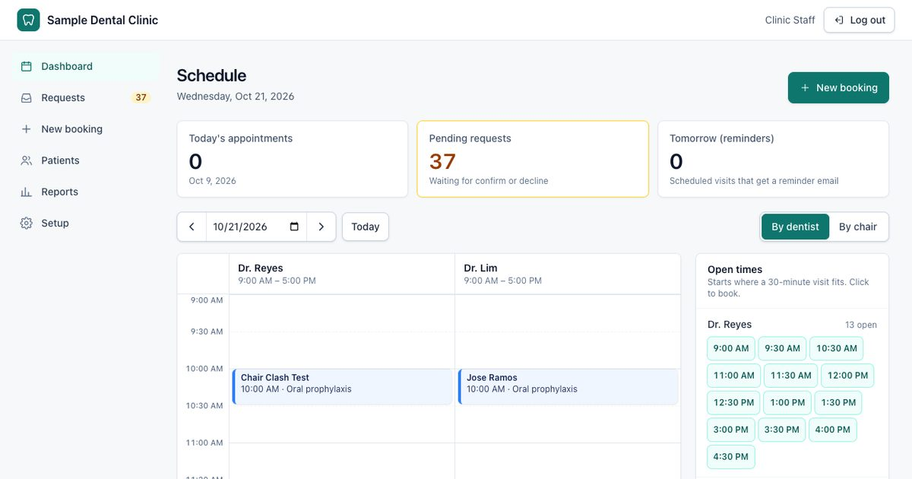
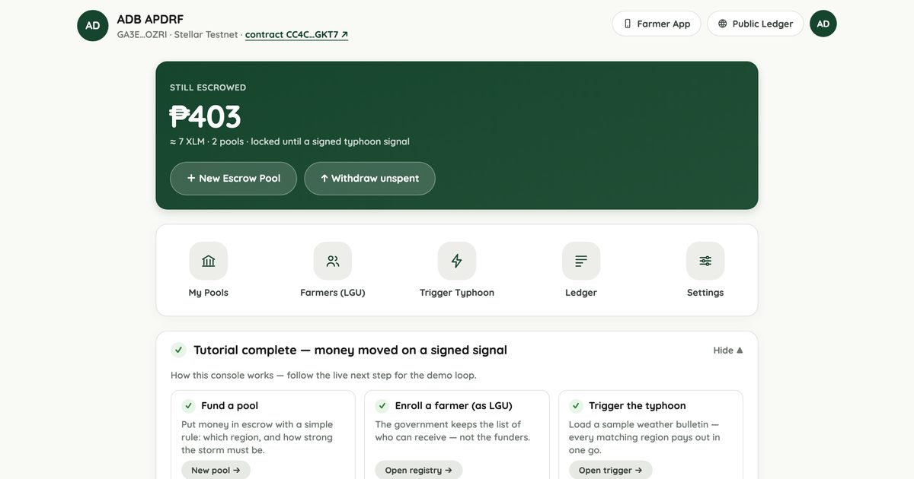
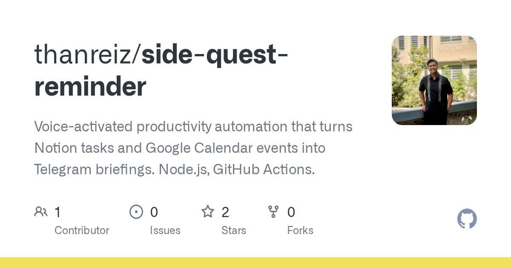
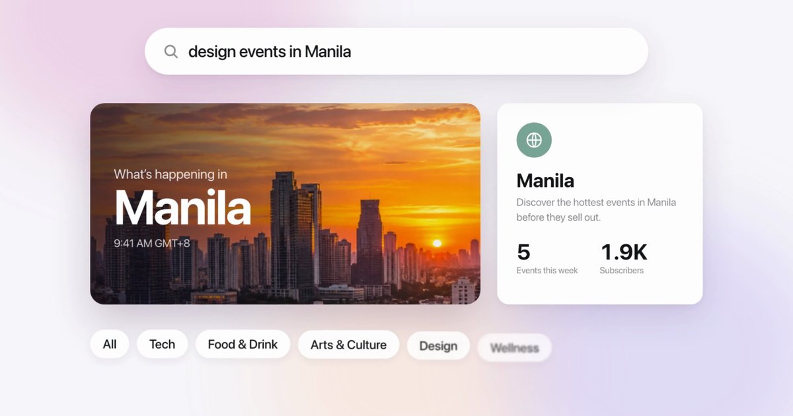

<!-- HEADER -->

  
  
  

## About Me

Full-stack developer and BS Computer Science student at **Pamantasan ng Lungsod ng Maynila (PLM)**, studying as a **DOST-SEI undergraduate scholar**. I build web and mobile applications end to end — from UI/UX design in Figma to tested, deployed production code — and lead technical teams in student organizations and hackathons.

**Open to junior and part-time software developer roles.**

## Experience

- **UI/UX Developer Intern — Omni-Channel Solutions** *(Jun 2026 – Aug 2026)*
  - Found a billing leak in an Amazon Seller Central integration during an audit of real production data ($120 leaked in May, $136 in the first 10 days of June).
  - Shipped an internal tool for the ads team that merges Merchantspring, Google Sheets, and Amazon Seller Central data, replacing manual per-client cross-referencing; led TDR/PDR planning and UI/UX design.
- **Innovation Fellow, Strategy & Management Track — Eskwelabs** *(May 2026 – Aug 2026)*
  - Built a synthetic hospital patient-flow dataset, EDA, and challenge brief now used by Data Analytics Cohort 10.

## Leadership

- **Chief Technology Officer — START-DOST** *(Nov 2025 – present)*. Co-organizes TechStart, a monthly technical seminar series for DOST scholars; leads committee check-ins and task delegation.
- **Campus Leader — Notion** *(Aug 2026 – present)*. Organizing Build with Notion 2027, planned as the first Notion Summit in the Philippines (Q1 2027).
- **External Relations Lead — GDGoC PLM** *(Jun 2026 – present)*. Leads outreach to AI, automation, and workflow communities for joint events.
- **Program Committee — AWS User Group e:Novators PH** *(Apr 2026 – present)*. Lead organizer of Nova Launchpad 2026.
- **Student Leader Volunteer — Data Engineering Pilipinas** *(Feb 2026 – present)*. Contributed to curriculum design for the first cohort; managed records for 5,000+ DataCamp Scholars.

## Speaking

- OpenAI Codex Meetup — *Creating WAIS with Codex*
- Sip&Scale × Notion — *Automated Workflow*
- START-DOST TechStart October — *Think with AI*

## Technical Skills

- **Languages:** Java, Python, Kotlin, TypeScript, JavaScript, Rust, C
- **Frameworks:** React, React Native, Next.js, Jetpack Compose, Node.js, Tailwind CSS
- **Data and infrastructure:** MySQL, Docker, Git, GitHub Actions, Vercel, Stellar SDK, Soroban
- **Testing:** Vitest, Playwright
- **Design:** Figma, UI/UX auditing, Adobe Photoshop, Premiere Pro, After Effects
- **Automation and AI tooling:** REST API integration and workflow automation (Notion, Google Calendar, Telegram, Messenger), Claude Code, context engineering

## Featured Projects

<table width="100%">
  <tr>
    <td valign="top" width="50%">
      
      <h3><a href="https://github.com/thanreiz/dentalclinic">Molar &amp; Co.</a></h3>
      <b>Lead Developer and sole UI/UX Designer</b>
      
Web-based appointment scheduling and attendance tracking system for a small dental clinic. Prevents double-bookings across web, Messenger, phone, and walk-in channels. Verified by 492 unit/integration tests and 33 end-to-end tests. Documented in a co-authored research paper at PLM (ResearchGate publication planned).

      <b>Stack:</b> Next.js, TypeScript, MySQL 
      <a href="https://molarandco.vercel.app">Live demo</a> · <a href="https://github.com/thanreiz/dentalclinic">Source code</a>
    </td>
    <td valign="top" width="50%">
      
      <h3><a href="https://github.com/thanreiz/Celerity">Celerity</a></h3>
      <b>Blockchain and Full-Stack Developer · 2nd Place, Stellar APAC Hackathon 2026</b>
      
Programmable disaster-relief disbursement on the Stellar network. Rust/Soroban escrow contract, 2-of-3 Ed25519 weather oracle, automatic payouts to registered farmers, and SEP-31 anchor cash-out to PHP. Live on testnet with 46/46 contract tests passing and a verified on-chain settlement cost of about ₱0.125.

      <b>Stack:</b> Rust (Soroban), React, Vite, Stellar 
      <a href="https://stellar-celerity.me">Live demo</a> · <a href="https://github.com/thanreiz/Celerity">Source code</a>
    </td>
  </tr>
  <tr>
    <td valign="top" width="50%">
      
      <h3><a href="https://github.com/thanreiz/CrossCampus">Gabay</a></h3>
      <b>Full-Stack Developer and Project Manager · Grand Champion, FEU Tech ACM TechSprint 2026</b>
      
Offline-first AI math companion for Filipino Grade 4–6 learners. React 19 PWA with a Three.js 3D classroom, a Gemini and on-device Gemini Nano tutor, and 155 DepEd MATATAG competencies cached in IndexedDB. Built by a 4-person team; hackathon-stage, not yet tested with students.

      <b>Stack:</b> React, Three.js, Gemini API, IndexedDB 
      <a href="https://gabay-sage.vercel.app">Live demo</a> · <a href="https://github.com/thanreiz/CrossCampus">Source code</a>
    </td>
    <td valign="top" width="50%">
      
      <h3><a href="https://github.com/thanreiz/side-quest-reminder">Side Quest Reminder</a></h3>
      <b>Lead Developer · Personal project</b>
      
Voice-activated productivity engine that combines Notion tasks and Google Calendar events into focused Telegram briefings, triggered through Siri Shortcuts and run four times daily on scheduled GitHub Actions.

      <b>Stack:</b> Node.js, GitHub Actions, Notion API, Google Calendar API, Telegram Bot API 
      <a href="https://github.com/thanreiz/side-quest-reminder/actions">Live workflow runs</a> · <a href="https://github.com/thanreiz/side-quest-reminder">Source code</a>
    </td>
  </tr>
  <tr>
    <td valign="top" colspan="2">
      
      <h3><a href="https://www.figma.com/design/XdGah09Awb7dSLExqWJxK8/Luma-for-iPad-%E2%80%94-Concept?node-id=11-83">Luma for iPad — Concept Redesign</a></h3>
      <b>UI/UX Designer and Motion Designer · Personal project (Nov 2026)</b>
      
Redesign of Luma's event app for iPad: 13 screens across attendee and host flows in light and dark mode, built on a documented foundations-and-components design system in Figma. Paired with a 44-second launch-style motion ad (1080p, 60 fps) rendered frame by frame from live HTML UI with Playwright and ffmpeg, with beat-synced cuts, kinetic typography, and synthesized sound effects. Unofficial concept, not affiliated with Luma.

      <b>Tools:</b> Figma, HTML/CSS, Playwright, ffmpeg, Python (NumPy) 
      <a href="https://www.figma.com/design/XdGah09Awb7dSLExqWJxK8/Luma-for-iPad-%E2%80%94-Concept?node-id=11-83">Figma file</a> · <a href="https://www.facebook.com/share/p/1519owfS5St/">Watch the motion ad</a>
    </td>
  </tr>
</table>

## More Projects

- **[PLManilaProf](https://plmprof.vercel.app)** — Anonymous, ad-free professor-rating directory for PLM students, with separate teaching and grading scores, content reporting, and a faculty right of reply. Independent student project, not affiliated with PLM. *TypeScript.* [Live site](https://plmprof.vercel.app)
- **[START: Collections](https://github.com/dost-start/finance-igp)** — Solo full-stack developer. Official merchandise shop of START-DOST, built for the Finance team with Marketing, with GCash checkout, receipt verification (Tesseract.js OCR), and an admin back office for the finance team. *Next.js, Supabase (Postgres), Drizzle ORM, Vitest, Playwright.* Official launch planned for 2027. [Preview](https://start-shop-six.vercel.app) · [Source code](https://github.com/dost-start/finance-igp)

## Hackathon Achievements

| Result | Event | Project | Role | Stack |
|--------|-------|---------|------|-------|
| **Grand Champion** | GDGoC PLM Innolympics 2026 | [WAIS](https://github.com/thanreiz/wais-inno) | Full-Stack Developer and Researcher | Kotlin, Jetpack Compose, Gemini API |
| **Omni Special Award** | GDGoC PLM Innolympics 2026 | [WAIS](https://github.com/thanreiz/wais-inno) | Full-Stack Developer and Researcher | Kotlin, Jetpack Compose, Gemini API |
| **Grand Champion** | FEU Tech ACM TechSprint 2026 | [Gabay](https://github.com/thanreiz/CrossCampus) | Full-Stack Developer and Project Manager | React, Three.js, Gemini Nano |
| **2nd Place, APAC · Top 10 Finalist** | Stellar APAC Hackathon 2026 | [Celerity](https://github.com/thanreiz/Celerity) | Blockchain and Full-Stack Developer | Rust (Soroban), React, Vite |
| **3rd Place (2nd Runner-Up)** | Build Over Nights 2026 (Kiro × Amazon Quick), Climate Change track | [AIDE-M](https://github.com/DavidBatoDev/mangrove) | Researcher | Next.js, MapLibre, FastAPI, PostGIS, Sentinel-2 data |
| **Audience Choice Award (₱10,000)** | Build Over Nights 2026 (Kiro × Amazon Quick) | [AIDE-M](https://github.com/DavidBatoDev/mangrove) | Researcher | Next.js, MapLibre, FastAPI, PostGIS, Sentinel-2 data |
| **Top 5 Finalist** (face-to-face pitching pending) | Velo × Noir Agentic Payment Hackathon | [Sailo](https://github.com/pdyntech/sailo) ([live](https://sailo.pdyntech.com)) | Developer (team of 3) | TypeScript, Stellar |

<b>Other hackathon builds</b>

 

| Event | Project | Role | Stack |
|-------|---------|------|-------|
| Build on Stellar Philippines 2026 | [SariSync Ledger](https://github.com/thanreiz/SariSync-Ledger) | Lead Developer | Expo, React Native, Rust (Soroban) |
| Bountiful Harvest Hackathon, ACSS UPLB (Feb 2026) | [Agri.PH](https://github.com/thanreiz/Agri.ph) | Lead Developer and Researcher | Kotlin, Jetpack Compose |
| Musicathon 2026 | [Myusika](https://github.com/thanreiz/musicathon) | Developer | Next.js, TypeScript |
| PayPal and AI Hackathon | [Celerity Relief](https://github.com/thanreiz/celerity-paypal) ([live](https://celerity-relief.vercel.app)) | Full-Stack Developer | Node.js, Express, React, PayPal APIs, AI agents |

## Education and Scholarships

- **BS Computer Science** — Pamantasan ng Lungsod ng Maynila *(2025 – 2029)*
  - DOST-SEI Undergraduate Scholar (RA 7687) · Yoshii Family Inc. Scholar · DataCamp Scholar
- **STEM Senior High School** — Jose Rizal University *(2019 – 2025)*
  - Type A Scholar · Editor-in-Chief Scholarship · High Honors

## Certifications

- Google AI Professional Certificate — Google, June 2026

## GitHub Activity

 

## Contact

